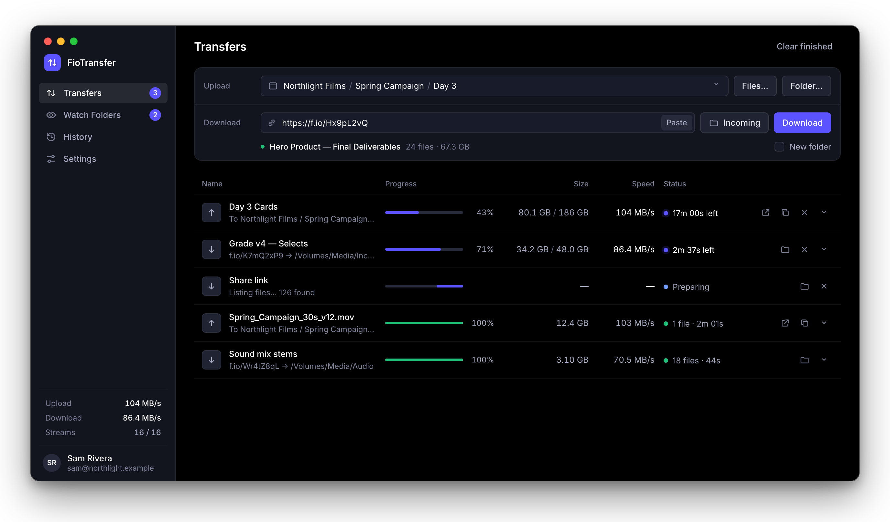

# FioTransfer

Fast uploads to and downloads from Frame.io, for macOS.



FioTransfer is a desktop app that replaces Frame.io's Transfer app. It moves files as fast as your connection allows and keeps a record of every transfer.

## What it does

- **Downloads from any Frame.io link:** share links, review links and `f.io` short links, from any account, including passphrase-protected ones. Files go to the folder you choose, with their folder structure, and you don't need to sign in.
- **Uploads files and folders:** drop anything onto the window. Folders are recreated in Frame.io, and you get a link to the uploaded files right away.
- **Runs at full speed:** each transfer is split across many parallel connections, measured at over 900 Mbit/s.
- **Picks up where it stopped:** interrupted downloads continue from the last finished piece, and failed uploads can be retried from History.
- **Watches folders:** anything that lands in a watched folder uploads automatically once it has finished copying.
- **Logs every transfer:** each one is listed in History, with a log file saved next to the media.
- **Keeps running in the menu bar:** close the window and transfers carry on. It can also start at login.
- **Works from the command line:** the `fio` tool does downloads and uploads from scripts.

## Install

Paste this into Terminal. It installs the latest release to Applications, and running it again updates the app:

```sh
curl -fsSL https://raw.githubusercontent.com/farbhaus/FioTransfer/main/scripts/install.sh | sh
```

FioTransfer needs macOS 13 or later and runs on Apple silicon and Intel Macs.

Or download the `.dmg` from [Releases](https://github.com/farbhaus/FioTransfer/releases) and drag FioTransfer to Applications. The app isn't notarized by Apple yet, so macOS blocks the first launch with "Apple could not verify…". Click **Done**, then open **System Settings → Privacy & Security** and click **Open Anyway**.

## Set up uploads

Downloads work straight away. Uploads need a free Adobe developer credential, set up once:

1. In the [Adobe Developer Console](https://developer.adobe.com/console), create a project and add the **Frame.io API** with **User Authentication → OAuth Single Page App**.
2. Set both the default redirect URI and the redirect URI pattern to `https://localhost:8765/callback`.
3. Paste the **Client ID** into **FioTransfer → Settings** and click **Sign in with Adobe**.

On your first sign-in, macOS asks for your password once to trust FioTransfer's local certificate, which the sign-in page needs.

## Build from source

You need Go 1.27, the Xcode Command Line Tools and the Wails CLI.

```sh
go install github.com/wailsapp/wails/v2/cmd/wails@v2.16.0
make app    # builds FioTransfer.app
make test   # runs the engine tests
```

---

FioTransfer is an independent project, not affiliated with Adobe or Frame.io.
